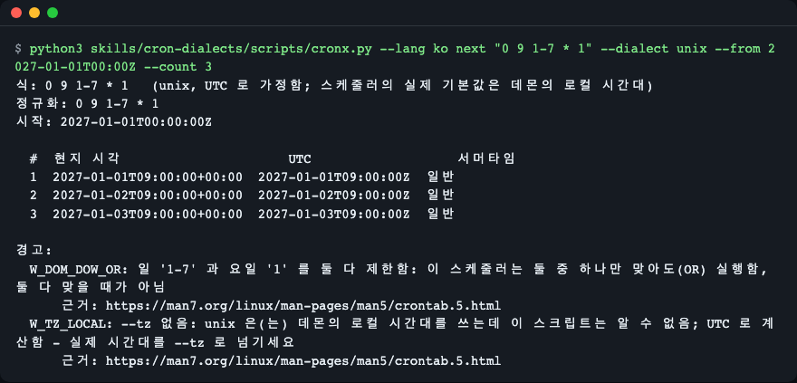
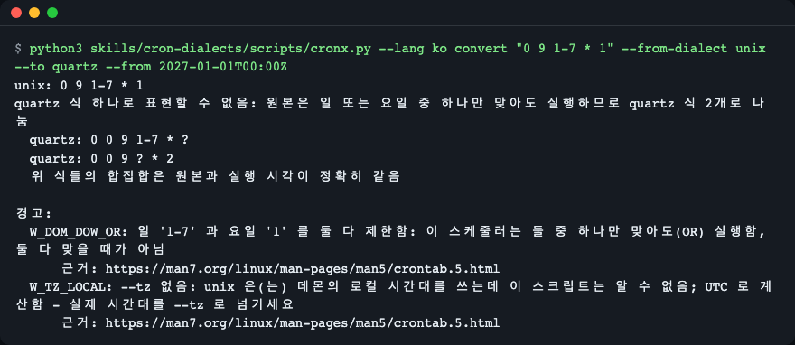
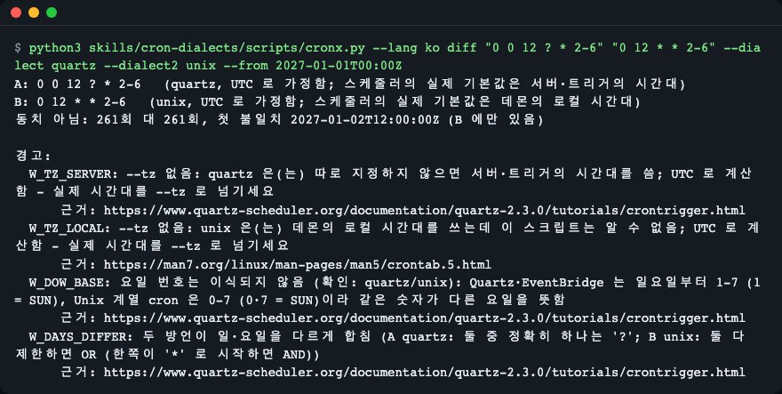
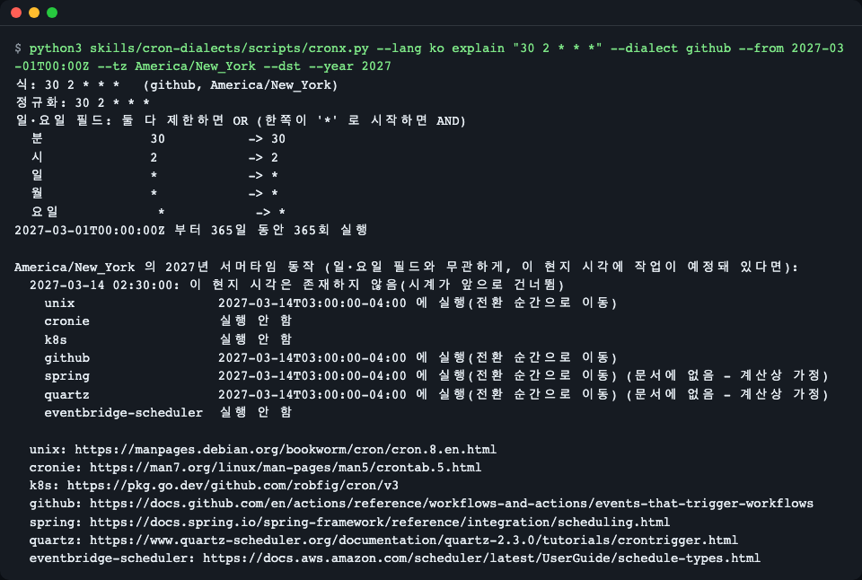
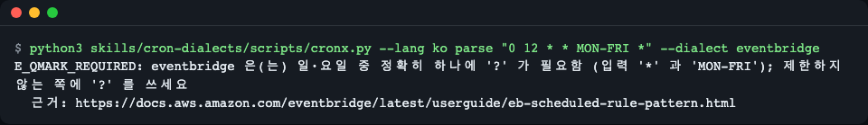
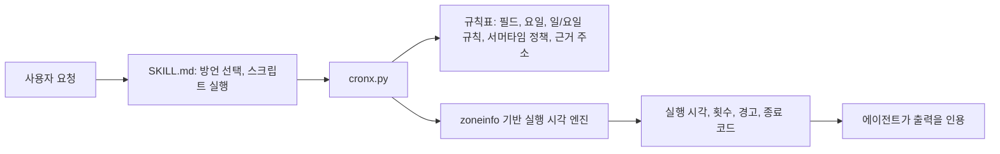

# cron-dialects

[English](README.md) | **한국어**

코딩 에이전트가 cron 스케줄을 머릿속으로 세지 않고, 스케줄러별(crontab, Kubernetes CronJob, GitHub Actions, Spring, Quartz, AWS EventBridge) 실제 실행 시각을 시간대·서머타임까지 계산하고, 방언 변환을 1년치 실행 시각 비교로 증명하게 해 주는 에이전트 스킬입니다.


*같은 문자열 `0 9 1-7 * 1` 은 crontab 에서 1-7일 이거나 매주 월요일에 실행되므로 첫 3회가 1월 1, 2, 3일입니다. 스크립트가 경고와 근거 주소를 함께 출력합니다.*

## 무엇을 하나
- **다음 실행 시각**: 방언·시간대·고정 시작 시각 기준으로 실제 실행 시각을 나열하고, 경고(`W_DOM_DOW_OR`, `W_TZ_LOCAL` 등)와 근거 문서 주소를 붙입니다.
- **검증·설명**: 스케줄러 8종(`unix`, `cronie`, `k8s`, `github`, `spring`, `quartz`, `eventbridge`, `eventbridge-scheduler`), 잘못된 식은 고정 오류 코드와 종료 코드 2.
- **서머타임 표**: 시간대와 연도를 주면 건너뛰는 시각·두 번 오는 시각에 스케줄러마다 어떻게 동작하는지 보여 주고, 문서에 없는 동작은 단정하지 않고 "문서에 없음"으로 표시합니다.
- **변환과 증명**: 다른 방언으로 식을 바꾸고 항상 1년치 실행 시각을 비교해 `동치`, 첫 불일치를 보고하거나 한 식으로 안 되면 여러 규칙으로 나눕니다.
- 표준 라이브러리만 사용(Python 3.10+), 네트워크 없음, 메시지는 영어·한국어.

같은 cron 문자열도 스케줄러마다 뜻이 다릅니다. 아래 횟수는 2027년, UTC 기준입니다.

| 문자열 | 스케줄러 | 뜻 | 실행 횟수 |
|---|---|---|---|
| `0 9 1-7 * 1` | crontab | 1-7일 OR 월요일 | 124 |
| `0 0 9 1-7 * 1` (Spring 은 초 필드가 있음) | Spring | 1-7일 AND 월요일 | 12 |
| `0 0 */2 * 1` | crontab | `*/2` 를 제한 없음으로 봐서 AND | 27 |
| `0 0 */2 * 1` | Kubernetes | `*/2` 를 제한으로 봐서 OR | 211 |
| 요일 `2-6` | Quartz 대 crontab | Quartz 2-6 은 월-금, crontab 2-6 은 화-토 | 261 대 261, 요일이 다름 |

## 설치
**Claude Code**
```
/plugin marketplace add LeeGyeongPil/cron-dialects
/plugin install cron-dialects@cron-dialects-skill
```
**Agent Skills 표준을 읽는 다른 에이전트** — `skills/cron-dialects` 폴더를 에이전트의 스킬 폴더(예: 프로젝트의 `.agents/skills/`)에 복사하세요.

요구 사항: `python3` 3.10 이상, 표준 라이브러리만 사용. 스크립트는 OS 시간대 데이터베이스를 읽습니다. 최소 리눅스 이미지는 `tzdata` 패키지가 필요하고, Windows 는 `uv run --with tzdata python skills/cron-dialects/scripts/cronx.py ...` 로 실행하세요(없으면 종료 코드 4).

## 빠른 시작
스크립트를 직접 실행합니다(메시지 언어는 `--lang en` 또는 `--lang ko`).

```
python3 skills/cron-dialects/scripts/cronx.py next "0 9 1-7 * 1" --dialect unix --from 2027-01-01T00:00Z --count 3
```

```
식: 0 9 1-7 * 1   (unix, UTC 로 가정함; 스케줄러의 실제 기본값은 데몬의 로컬 시간대)
정규화: 0 9 1-7 * 1
시작: 2027-01-01T00:00:00Z

  #  현지 시각                      UTC                   서머타임
  1  2027-01-01T09:00:00+00:00  2027-01-01T09:00:00Z  일반
  2  2027-01-02T09:00:00+00:00  2027-01-02T09:00:00Z  일반
  3  2027-01-03T09:00:00+00:00  2027-01-03T09:00:00Z  일반

경고:
  W_DOM_DOW_OR: 일 '1-7' 과 요일 '1' 를 둘 다 제한함: 이 스케줄러는 둘 중 하나만 맞아도(OR) 실행함, 둘 다 맞을 때가 아님
      근거: https://man7.org/linux/man-pages/man5/crontab.5.html
  W_TZ_LOCAL: --tz 없음: unix 은(는) 데몬의 로컬 시간대를 쓰는데 이 스크립트는 알 수 없음; UTC 로 계산함 - 실제 시간대를 --tz 로 넘기세요
      근거: https://man7.org/linux/man-pages/man5/crontab.5.html
```

위 출력은 한국어 로캘에서 실행한 결과입니다(영어는 `--lang en`).

## 사용법
에이전트에게 평소 말투로 요청하면 됩니다. 평가 세트에서 스킬이 발동한 요청 예시입니다(영어 요청도 한국어 요청도 됩니다).

- "When will `0 9 1-7 * 1` run next? I meant the first Monday of every month."
- "My EventBridge rule rejects `cron(0 12 * * MON-FRI *)` - what's wrong with it?"
- "List the next 5 runs of `30 2 * * *` in America/New_York starting 2027-03-13."

워크플로의 `on:` 트리거 필터, iCalendar RRULE, systemd `OnCalendar`, 단순 시간대 변환 같은 이웃 요청에는 발동하지 않습니다.

**다른 스케줄러로 변환.** "매월 첫 월요일" 의도는 Quartz 식 하나로 쓸 수 없어서, 스크립트가 둘로 나누고 합집합이 같음을 증명합니다.

```
python3 skills/cron-dialects/scripts/cronx.py convert "0 9 1-7 * 1" --from-dialect unix --to quartz --from 2027-01-01T00:00Z
```


*원본은 일 또는 요일 중 하나만 맞으면 실행하므로 Quartz 에서는 규칙 2개가 필요합니다. 마지막 줄이 두 식의 합집합이 원본과 실행 시각이 정확히 같다는 뜻입니다. 종료 코드 1 은 "식 하나로는 안 됨" 입니다.*

**두 식 비교.** Quartz 는 요일을 일요일부터 1-7, crontab 은 0-7 로 세므로 `2-6` 을 그대로 옮기면 하루 밀립니다.

```
python3 skills/cron-dialects/scripts/cronx.py diff "0 0 12 ? * 2-6" "0 12 * * 2-6" --dialect quartz --dialect2 unix --from 2027-01-01T00:00Z
```


*실행 횟수가 같아도(261 대 261) 같은 스케줄이 아닙니다. 첫 불일치는 토요일 2027-01-02 로 crontab 쪽에만 있습니다. 종료 코드 1. 올바른 변환은 `0 12 * * 1-5` 입니다.*

**서머타임 날.** 서머타임이 시작되는 날 02:30 작업을 스케줄러마다 어떻게 처리할까요?

```
python3 skills/cron-dialects/scripts/cronx.py explain "30 2 * * *" --dialect github --from 2027-03-01T00:00Z --tz America/New_York --dst --year 2027
```


*뉴욕에서 2027-03-14 02:30 은 존재하지 않는 시각입니다. 03:00 으로 옮겨 실행하는 스케줄러도, 그날을 건너뛰는 스케줄러도 있고, 문서에 없는 동작은 "문서에 없음 - 계산상 가정" 으로 표시됩니다.*

**오류는 고칠 방법을 알려 줍니다.** 고정 코드와 종료 코드 2:

```
python3 skills/cron-dialects/scripts/cronx.py parse "0 12 * * MON-FRI *" --dialect eventbridge
```


*EventBridge 는 일·요일 중 정확히 한 곳에 `?` 가 필요합니다. 고친 식은 `0 12 ? * MON-FRI *` 입니다.*

**언어.** 메시지는 영어·한국어: `--lang en|ko`, 다음 `CRON_DIALECTS_LANG`, 다음 `LC_ALL`/`LC_MESSAGES`/`LANG` 순이고 한국어 로캘이 아니면 영어입니다. JSON 키와 코드는 언어와 무관합니다. Python 기본 인자 오류 문구는 영어로 남습니다.

## 지원 스케줄러
`python3 skills/cron-dialects/scripts/cronx.py dialects` 가 근거 주소가 붙은 이 표를 출력합니다(한 행만 보려면 `--dialect ID`). 2026-11-17 에 링크된 문서로 확인했습니다.

| id | 필드 | 요일 | 일 + 요일 결합 | 기본 시간대 | 서머타임 공백 / 중복 | 근거 |
|---|---|---|---|---|---|---|
| `unix` | 5 | 0-7 (0, 7 = 일) | 둘 다 제한하면 OR, 한쪽이 `*` 로 시작하면 AND | 데몬의 로컬 시간대 | 전환 순간에 실행 / 한 번(첫 번째) | [crontab(5)](https://man7.org/linux/man-pages/man5/crontab.5.html) |
| `cronie` | 5 | 0-7 | `unix` 와 같음 | 데몬의 로컬 시간대 | 건너뜀 / 두 번 | [crontab(5)](https://man7.org/linux/man-pages/man5/crontab.5.html) |
| `k8s` | 5 (`?` 허용) | 0-6 (0 = 일) | 둘 다 제한하면 OR, 한쪽이 정확히 `*` 또는 `?` 일 때만 AND(`*/2` 는 제한) | kube-controller-manager 의 로컬 시간대 | 건너뜀 / 한 번(중복은 문서에 없음) | [CronJob](https://kubernetes.io/docs/concepts/workloads/controllers/cron-jobs/) |
| `github` | 5 | 0-6 | 둘 다 제한하면 OR, 한쪽이 `*` 로 시작하면 AND | UTC | 전환 순간에 실행 / 한 번(중복은 문서에 없음) | [Events](https://docs.github.com/en/actions/reference/workflows-and-actions/events-that-trigger-workflows) |
| `spring` | 6 (초가 처음) | 0-7 | AND | 서버·트리거의 시간대 | 문서에 없음(가정) | [Spring scheduling](https://docs.spring.io/spring-framework/reference/integration/scheduling.html) |
| `quartz` | 6-7 (초가 처음, 연 선택) | 1-7 (1 = 일) | 둘 중 정확히 하나는 `?` | 서버·트리거의 시간대 | 문서에 없음(가정) | [CronTrigger](https://www.quartz-scheduler.org/documentation/quartz-2.3.0/tutorials/crontrigger.html) |
| `eventbridge` | 6 (연이 마지막) | 1-7 | 둘 중 정확히 하나는 `?` | UTC, 변경 불가 | 전환 순간에 실행 / 한 번 | [Rule patterns](https://docs.aws.amazon.com/eventbridge/latest/userguide/eb-scheduled-rule-pattern.html) |
| `eventbridge-scheduler` | 6 | 1-7 | 둘 중 정확히 하나는 `?` | UTC | 건너뜀 / 한 번(두 번째) | [Schedule types](https://docs.aws.amazon.com/scheduler/latest/UserGuide/schedule-types.html) |

k8s 행은 Kubernetes 가 쓰는 파서인 robfig/cron v3 규칙을 따릅니다. `0 0 */2 * 1` 은 2027년에 `k8s` 에서 211회, `unix` 에서 27회 실행됩니다.

```
python3 skills/cron-dialects/scripts/cronx.py diff "0 0 */2 * 1" "0 0 */2 * 1" --dialect unix --dialect2 k8s --from 2027-01-01T00:00Z
```

보고서에는 `not equivalent: 27 vs 211 runs, first mismatch 2027-01-01T00:00:00Z (only in B)`(영어 출력 기준)가 나오고 종료 코드 1, 경고는 `W_VIXIE_STAR`(`unix`)와 `W_ROBFIG_STEP`(`k8s`)입니다.

## 잡아 주는 함정
| 함정 | 스크립트 출력 |
|---|---|
| crontab 은 일과 요일을 OR 로 결합 | `0 9 1-7 * 1` 은 2027년에 `unix` 124회, `spring`(AND) 12회. 경고 `W_DOM_DOW_OR` / `W_DOM_DOW_AND` |
| 맨 앞 `*` 가 규칙을 바꿈(Vixie) | 일 필드 `*/2` 는 `unix`(AND) 27회, `k8s`(OR) 211회. `W_VIXIE_STAR`, `W_ROBFIG_STEP` |
| 방언마다 요일 번호가 다름 | Quartz `2-6` 대 crontab `2-6`: 261 대 261회, 첫 불일치 2027-01-02. `W_DOW_BASE` |
| 일·요일 중 정확히 한 곳에 `?` 필요(Quartz, EventBridge) | `E_QMARK_REQUIRED` 와 수정 방법, 종료 코드 2 |
| 기본 시간대가 예상과 다름 | GitHub·EventBridge 는 UTC, crontab·Kubernetes 는 데몬·컨트롤러의 시간대라서 경고(`W_TZ_LOCAL`, `W_TZ_CONTROLLER`)하고 UTC 로 계산; JSON `tz_note` 가 실제로 도는 시간대를 한 문장으로 알려 줌 |
| 서머타임 공백·중복 | `explain ... --dst --year 2027` 이 스케줄러별로 03:00 으로 이동·건너뜀·한 번·두 번을 나열 |
| 횟수는 같은데 다른 스케줄 | `diff` 는 횟수가 아니라 실행 시각을 비교 |

## 명령 참조
```
python3 skills/cron-dialects/scripts/cronx.py [--json] [--out FILE] [--lang en|ko] <command> ...
```

| 명령 | 인자와 옵션 | 하는 일 |
|---|---|---|
| `parse` | `EXPR --dialect D` | 검증하고 정규화한 식과 필드 값을 출력 |
| `next` | `EXPR --dialect D [--tz TZ] [--from ISO] [--count N \| --until ISO] [--show-tz TZ2]` | 실행 시각을 나열(기본 5개, 최대 1000개). `--show-tz` 는 두 번째 시간대 열을 추가 |
| `explain` | `EXPR --dialect D [--tz TZ] [--from ISO] [--days N] [--dst --year YYYY]` | 필드별 설명과 실행 횟수, `--dst` 면 스케줄러별 공백·중복 표 |
| `convert` | `EXPR --from-dialect A --to B [--tz TZ] [--from ISO] [--days N]` | 다른 방언으로 바꾸고 실행 시각 비교로 검증 |
| `diff` | `EXPR1 EXPR2 --dialect A --dialect2 B [--tz TZ] [--tz2 TZ] [--from ISO] [--days N]` | 두 식의 실행 시각을 비교해 첫 불일치를 보고 |
| `dialects` | `[--dialect D]` | 근거가 붙은 규칙표를 출력 |

- `--tz`: IANA 이름(`America/New_York`), `UTC`, 오프셋(`+09:00`). 생략하면 방언 기본값이고, 알 수 없으면 UTC 로 계산하며 경고합니다. EventBridge 규칙은 UTC 만 받습니다.
- `--from`: ISO 날짜·시각. `Z`·오프셋이 없으면 `--tz` 의 현지 시각입니다. 기본값은 현재 UTC. 같은 결과가 필요하면 항상 지정하세요.
- `--days`: `explain`·`convert`·`diff` 의 구간 길이, `[from, from + days)`. 기본 365, 최대 3660. `--tz2` 는 `diff` 의 두 번째 식 시간대(기본 `--tz`)입니다.
- `--json` 은 텍스트 대신 JSON 을 출력하고, `--out FILE` 은 JSON 을 파일에도 씁니다.

**JSON 키**(명령에 해당하는 것만 나옴): `command`, `dialect`, `dialect2`, `tz`, `tz2`, `tz_default`(`UTC`, `local`, `controller-local`, `server`; `diff` 는 `tz_default2`), `tz_assumed`(--tz 없이 UTC 로 대신 계산했으면 true; `diff` 는 `tz_assumed2`), `tz_note`(스케줄이 실제로 도는 시간대를 한 문장으로, 메시지 언어를 따름; `diff` 는 `tz_note2`), `normalized`, `normalized2`, `from`, `window`(`from`, `to`, `days`), `runs[]`(`local`, `utc`, `dst` = `normal`, `gap-shifted`, `fold-first`, `fold-second`), `equivalent`, `counts`(`a`, `b`), `first_mismatch`(`instant`, `only_in`), `warnings[]`(`code`, `message`, `source`), `convert` 는 `from_dialect`, `converted`, `split`, `reasons`, `split_equivalent`. 예:

```
python3 skills/cron-dialects/scripts/cronx.py next "0 12 * * *" --dialect unix --from 2027-01-01T00:00Z --count 2 --json --lang ko
```

```json
{
  "command": "next",
  "dialect": "unix",
  "tz": "UTC",
  "tz_default": "local",
  "tz_assumed": true,
  "tz_note": "데몬의 로컬 시간대 에서 실행됨; 표시한 시각은 실제 시간대를 --tz 로 넘기기 전까지 UTC 로 대신 계산한 값",
  "normalized": "0 12 * * *",
  "from": "2027-01-01T00:00:00Z",
  "runs": [
    { "local": "2027-01-01T12:00:00+00:00", "utc": "2027-01-01T12:00:00Z", "dst": "normal" },
    { "local": "2027-01-02T12:00:00+00:00", "utc": "2027-01-02T12:00:00Z", "dst": "normal" }
  ],
  "warnings": [ { "code": "W_TZ_LOCAL", "message": "...", "source": "https://man7.org/linux/man-pages/man5/crontab.5.html" } ]
}
```

(지면상 줄였습니다. 실제 출력은 키마다 줄을 나눠 들여쓰고 경고에 전체 메시지가 들어갑니다.)

**종료 코드**

| 코드 | 뜻 | 예 |
|---|---|---|
| 0 | 성공. `diff`·`convert` 는 동치 | |
| 1 | `diff` 비동치, 또는 `convert` 가 한 식으로 표현 불가 | `not equivalent: 261 vs 261 runs, first mismatch 2027-01-02T12:00:00Z (only in B)` |
| 2 | 사용법 또는 식 오류 | `E_QMARK_REQUIRED`, `E_FIELD_COUNT`, `E_UNKNOWN_TZ: unknown time zone 'Mars/Base'` |
| 3 | 검색 범위(3660일 또는 연 필드 끝) 안에 실행 없음 | `0 0 30 2 *` 의 `E_NO_RUN` |
| 4 | 시간대 데이터베이스 없음 | `E_NO_TZDATA`: `uv run --with tzdata python ...` 로 실행 |

## 검증 결과
<!-- skill-eval:start -->
<!-- skill-eval:end -->

## 동작 원리



`SKILL.md` 는 에이전트가 식이 들어 있는 곳으로 방언을 고르고, 항상 고정 `--from` 을 주고, 스크립트 출력을 경고와 함께 인용하도록 안내합니다. `cronx.py` 는 자체 규칙표와 OS 시간대 데이터베이스만 읽으며 네트워크도 Python 실행 외 권한도 필요 없습니다. `--out` 을 줄 때만 파일을 씁니다.

계산 방식: 방언 규칙은 표 하나에 데이터로 있고 엔진은 그 표만 읽습니다. 월로 거른 뒤 어떤 날이 맞는지(OR, Vixie 첫 `*` 규칙, AND, `?` 배타) 정하고, 시·분·초 집합을 곱한 다음 벽시계 시각을 순간으로 바꿉니다. 서머타임 변경이 없는 날은 하루에 UTC 오프셋을 한 번만 구합니다. 전환이 낀 날은 `fold` 두 값을 비교해 공백인지 중복인지 가리고, 정확한 전환 순간은 이분 탐색으로 찾습니다. `diff` 와 `convert` 는 반열린 구간의 실행 시각을 비교하므로 횟수만 같은 경우가 동치로 통과하지 않습니다.

문서에 있는 동작은 각 스케줄러 문서에서 가져오며(결과마다 주소 출력), 문서가 침묵하는 부분(예: GitHub 의 일/요일 결합 규칙, Spring·Quartz 의 서머타임 처리)은 가정으로 계산하고 `W_COMBINE_ASSUMED`, `W_DST_UNDOCUMENTED` 로 표시합니다. Python 라이브러리끼리도 이런 경우 답이 다르며(croniter 7.0.0 은 중복일 01:30 을 두 번, cronsim 2.8 은 한 번 반환, 2026-11-17 확인) 그래서 모든 결과에 근거 주소가 붙습니다.

## 언제 쓰나
잘 맞는 상황: crontab, Kubernetes, GitHub Actions, Spring, Quartz, EventBridge 사이에서 스케줄을 검토·이전할 때, "이 식이 실제로 언제 실행되고 서머타임 날엔 어떻게 되나" 를 물을 때.

다른 작업에는 다른 도구가 나을 수 있습니다. 범용 cron 라이브러리·CLI 는 [croniter](https://github.com/pallets-eco/croniter), [cronsim](https://github.com/cuu508/cronsim)(지원 방언은 각 문서를 확인하세요), 실제 실행 내역은 해당 스케줄러 자체 도구를 보세요.

## 한계와 로드맵
- 지원하지 않음: 워크플로 트리거 필터, iCalendar RRULE, systemd `OnCalendar`, GCP Cloud Scheduler, Jenkins `H`, 단순 시간대 변환. 스케줄러를 더 지원하는 것이 다음 후보입니다.
- 스케줄러 문서가 정하지 않은 서머타임 동작(Spring·Quartz 의 공백·중복, GitHub·Kubernetes 의 중복)은 가정으로 계산하고 `W_DST_UNDOCUMENTED` 로 표시합니다. 실제 스케줄러에서 확인하세요.
- GitHub 의 일/요일 결합 규칙은 문서에 없어서 OR 로 계산하고 `W_COMBINE_ASSUMED` 로 표시합니다.
- EventBridge 의 `L-n`·`LW` 는 문서에 설명이 없어 허용하지 않습니다.
- Python 기본 인자 오류 문구(예: "the following arguments are required")는 `--lang ko` 에서도 영어이고, `E_USAGE:` 접두만 고정입니다.
- 스크립트는 crontab 데몬, kube-controller-manager, Spring/Quartz 서버의 시간대를 알 수 없습니다. `--tz` 가 없으면 UTC 로 계산하고 `tz_assumed: true` 를 켜며 `tz_note` 에 실제 기본값을 적습니다. 실제 시간대는 `--tz` 로 넘기세요.
- 검색 범위는 3660일이며, `next --until`·`diff`·`convert` 에서 실행이 1,100,000회를 넘는 구간은 거부합니다(`E_TOO_MANY_RUNS`). `explain` 은 거부하지 않고 실행 횟수를 `null` 로 두며 종료 코드 0 입니다.

## 개발
```
uv sync && uv run pytest -q
```
마지막 실행 결과: `166 passed`. 평가 세트는 `evals/`(trigger 13, non-trigger 12, task 6 케이스와 fixture·grader)에 있고 `claude plugin eval` 로 돌립니다.

## 라이선스
MIT
