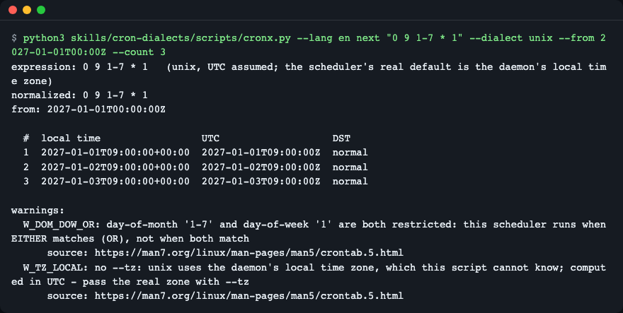
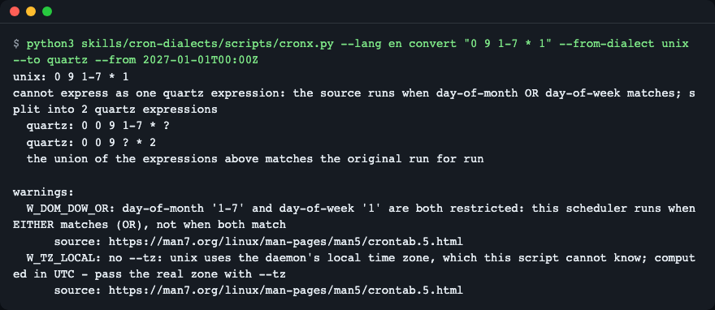
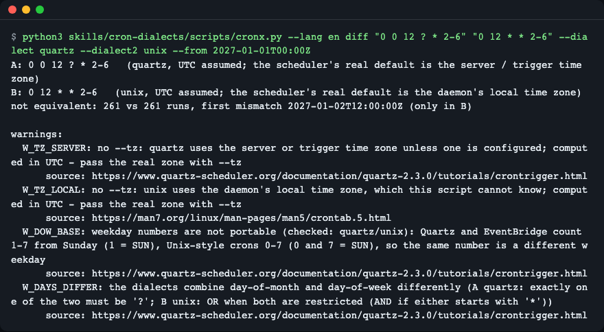
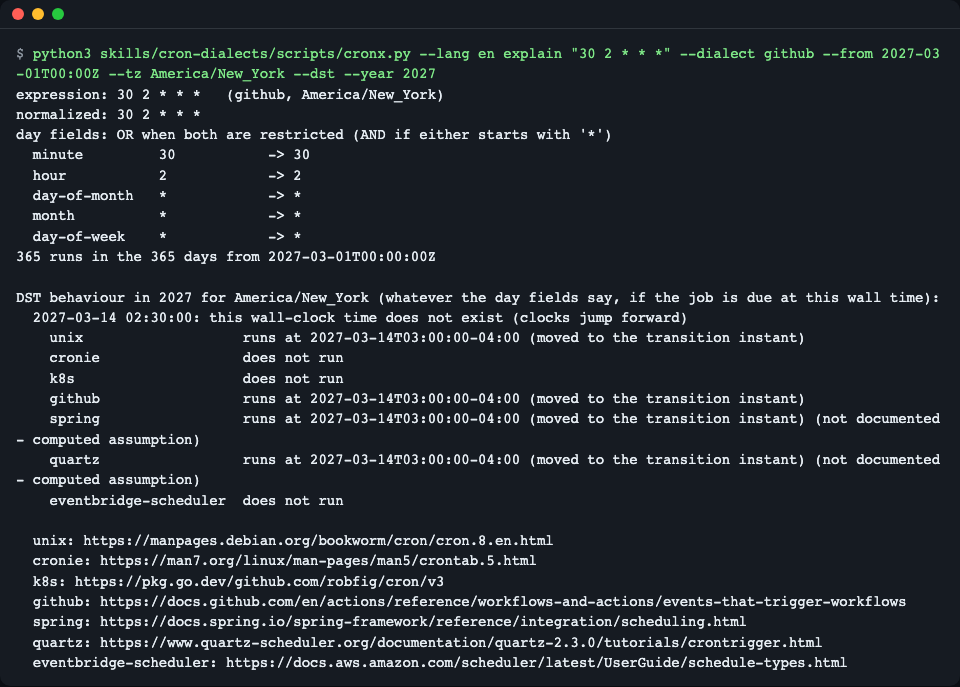
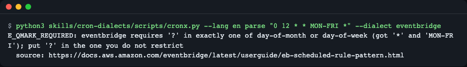
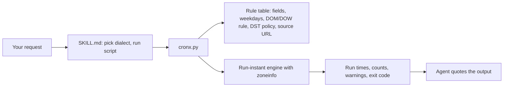

# cron-dialects

**English** | [한국어](README.ko.md)

An agent skill that makes your coding agent compute real run times for cron schedules per scheduler (crontab, Kubernetes CronJob, GitHub Actions, Spring, Quartz, AWS EventBridge), including time zones and DST, and prove dialect conversions by diffing a year of run instants, instead of counting in its head.


*The same text `0 9 1-7 * 1` runs on days 1-7 OR every Monday in crontab, so the first three runs are Jan 1, 2, 3. The script prints the warning and its source.*

## What it does
- **Next runs**: lists real run instants for a dialect, a time zone and a fixed start time, with warnings (`W_DOM_DOW_OR`, `W_TZ_LOCAL`, ...) and the documentation URL behind each.
- **Validate and explain**: eight scheduler ids (`unix`, `cronie`, `k8s`, `github`, `spring`, `quartz`, `eventbridge`, `eventbridge-scheduler`) with fixed error codes and exit code 2 on invalid input.
- **DST table**: for a zone and year, shows what each scheduler does at the skipped and repeated wall-clock times, and marks behaviour its documentation does not state as "not documented" instead of asserting it.
- **Convert and prove**: rewrites an expression for another dialect and always compares one year of run instants; reports `equivalent`, the first mismatch, or splits into several rules when one expression cannot express it.
- Standard library only (Python 3.10+), no network access, messages in English and Korean.

The same cron text means different things in different schedulers. Counts below are for 2027, UTC:

| Text | Scheduler | Meaning | Runs |
|---|---|---|---|
| `0 9 1-7 * 1` | crontab | day 1-7 OR Monday | 124 |
| `0 0 9 1-7 * 1` (Spring has a seconds field) | Spring | day 1-7 AND Monday | 12 |
| `0 0 */2 * 1` | crontab | `*/2` counts as unrestricted, so AND | 27 |
| `0 0 */2 * 1` | Kubernetes | `*/2` counts as restricted, so OR | 211 |
| `2-6` as weekdays | Quartz vs crontab | Quartz 2-6 is Mon-Fri, crontab 2-6 is Tue-Sat | 261 vs 261, different days |

## Install
**Claude Code**
```
/plugin marketplace add LeeGyeongPil/cron-dialects
/plugin install cron-dialects@cron-dialects-skill
```
**Other agents (Agent Skills standard)** — copy `skills/cron-dialects` into the agent's skills folder (for example `.agents/skills/` in a project).

Requirements: `python3` 3.10 or newer, standard library only. The script reads the OS time zone database: minimal Linux images need the `tzdata` package, Windows needs `uv run --with tzdata python skills/cron-dialects/scripts/cronx.py ...` (exit code 4 otherwise).

## Quick start
Run the script directly (add `--lang en` or `--lang ko` to pick the message language):

```
python3 skills/cron-dialects/scripts/cronx.py next "0 9 1-7 * 1" --dialect unix --from 2027-01-01T00:00Z --count 3
```

```
expression: 0 9 1-7 * 1   (unix, UTC assumed; the scheduler's real default is the daemon's local time zone)
normalized: 0 9 1-7 * 1
from: 2027-01-01T00:00:00Z

  #  local time                 UTC                   DST
  1  2027-01-01T09:00:00+00:00  2027-01-01T09:00:00Z  normal
  2  2027-01-02T09:00:00+00:00  2027-01-02T09:00:00Z  normal
  3  2027-01-03T09:00:00+00:00  2027-01-03T09:00:00Z  normal

warnings:
  W_DOM_DOW_OR: day-of-month '1-7' and day-of-week '1' are both restricted: this scheduler runs when EITHER matches (OR), not when both match
      source: https://man7.org/linux/man-pages/man5/crontab.5.html
  W_TZ_LOCAL: no --tz: unix uses the daemon's local time zone, which this script cannot know; computed in UTC - pass the real zone with --tz
      source: https://man7.org/linux/man-pages/man5/crontab.5.html
```

## Use it
Ask your agent in plain words. These requests trigger the skill in the evaluation set (the skill also triggers on Korean requests):

- "When will `0 9 1-7 * 1` run next? I meant the first Monday of every month."
- "My EventBridge rule rejects `cron(0 12 * * MON-FRI *)` - what's wrong with it?"
- "List the next 5 runs of `30 2 * * *` in America/New_York starting 2027-03-13."

It does not trigger for neighbouring requests such as a workflow's `on:` trigger filters, iCalendar RRULE, systemd `OnCalendar`, or plain time zone conversion.

**Convert to another scheduler.** The first-Monday intent cannot be one Quartz expression, so the script splits it and proves the union matches:

```
python3 skills/cron-dialects/scripts/cronx.py convert "0 9 1-7 * 1" --from-dialect unix --to quartz --from 2027-01-01T00:00Z
```


*The original runs when day-of-month OR day-of-week matches, so Quartz needs two rules. The last line says their union matches the original run for run. Exit code 1 means "not one expression".*

**Compare two expressions.** Quartz numbers weekdays 1-7 from Sunday, crontab 0-7, so copying `2-6` across shifts the schedule by a day:

```
python3 skills/cron-dialects/scripts/cronx.py diff "0 0 12 ? * 2-6" "0 12 * * 2-6" --dialect quartz --dialect2 unix --from 2027-01-01T00:00Z
```


*Equal counts (261 vs 261) do not mean equal schedules. The first mismatch is Saturday 2027-01-02, which only the crontab version runs. Exit code 1. The correct conversion is `0 12 * * 1-5`.*

**DST day.** What does each scheduler do with a job at 02:30 on the spring-forward day?

```
python3 skills/cron-dialects/scripts/cronx.py explain "30 2 * * *" --dialect github --from 2027-03-01T00:00Z --tz America/New_York --dst --year 2027
```


*On 2027-03-14 02:30 does not exist in New York. Some schedulers move the run to 03:00, others skip the day; where the documentation is silent the line says "not documented - computed assumption".*

**Errors name the fix.** Exit code 2 with a fixed code:

```
python3 skills/cron-dialects/scripts/cronx.py parse "0 12 * * MON-FRI *" --dialect eventbridge
```


*EventBridge needs `?` in exactly one of day-of-month and day-of-week. The fixed expression is `0 12 ? * MON-FRI *`.*

**Language.** Messages are English or Korean: `--lang en|ko`, then `CRON_DIALECTS_LANG`, then `LC_ALL`/`LC_MESSAGES`/`LANG`; English unless the locale is Korean. JSON keys and codes do not change with the language. Python's built-in argument error text stays English.

## Supported schedulers
`python3 skills/cron-dialects/scripts/cronx.py dialects` prints this table with sources (`--dialect ID` for one row). Checked 2026-11-17 against the linked documents.

| id | Fields | Weekdays | Day-of-month + day-of-week | Default time zone | DST gap / fold | Source |
|---|---|---|---|---|---|---|
| `unix` | 5 | 0-7 (0, 7 = SUN) | OR when both restricted; AND if either starts with `*` | daemon's local zone | runs at the transition / once (first) | [crontab(5)](https://man7.org/linux/man-pages/man5/crontab.5.html) |
| `cronie` | 5 | 0-7 | same as `unix` | daemon's local zone | skipped / twice | [crontab(5)](https://man7.org/linux/man-pages/man5/crontab.5.html) |
| `k8s` | 5 (`?` allowed) | 0-6 (0 = SUN) | OR when both restricted; AND only if one is exactly `*` or `?` (`*/2` is restricted) | kube-controller-manager's local zone | skipped / once (fold not documented) | [CronJob](https://kubernetes.io/docs/concepts/workloads/controllers/cron-jobs/) |
| `github` | 5 | 0-6 | OR when both restricted; AND if either starts with `*` | UTC | runs at the transition / once (fold not documented) | [Events](https://docs.github.com/en/actions/reference/workflows-and-actions/events-that-trigger-workflows) |
| `spring` | 6 (seconds first) | 0-7 | AND | server or trigger zone | not documented (assumed) | [Spring scheduling](https://docs.spring.io/spring-framework/reference/integration/scheduling.html) |
| `quartz` | 6-7 (seconds first, optional year) | 1-7 (1 = SUN) | exactly one of the two is `?` | server or trigger zone | not documented (assumed) | [CronTrigger](https://www.quartz-scheduler.org/documentation/quartz-2.3.0/tutorials/crontrigger.html) |
| `eventbridge` | 6 (year last) | 1-7 | exactly one of the two is `?` | UTC, fixed | runs at the transition / once | [Rule patterns](https://docs.aws.amazon.com/eventbridge/latest/userguide/eb-scheduled-rule-pattern.html) |
| `eventbridge-scheduler` | 6 | 1-7 | exactly one of the two is `?` | UTC | skipped / once (second pass) | [Schedule types](https://docs.aws.amazon.com/scheduler/latest/UserGuide/schedule-types.html) |

The k8s row follows robfig/cron v3, the parser Kubernetes uses. `0 0 */2 * 1` runs 211 times in 2027 on `k8s` and 27 times on `unix`:

```
python3 skills/cron-dialects/scripts/cronx.py diff "0 0 */2 * 1" "0 0 */2 * 1" --dialect unix --dialect2 k8s --from 2027-01-01T00:00Z
```

The report says `not equivalent: 27 vs 211 runs, first mismatch 2027-01-01T00:00:00Z (only in B)`, exit code 1, with warnings `W_VIXIE_STAR` (for `unix`) and `W_ROBFIG_STEP` (for `k8s`).

## Pitfalls it catches
| Pitfall | What the script prints |
|---|---|
| Day-of-month and day-of-week are ORed in crontab | `0 9 1-7 * 1` gives 124 runs in 2027 on `unix`, 12 on `spring` (AND); warning `W_DOM_DOW_OR` / `W_DOM_DOW_AND` |
| A leading `*` changes the rule (Vixie) | `*/2` in the day field gives 27 runs on `unix` (AND), 211 on `k8s` (OR); `W_VIXIE_STAR`, `W_ROBFIG_STEP` |
| Weekday numbers shift between dialects | Quartz `2-6` vs crontab `2-6`: 261 vs 261 runs, first mismatch 2027-01-02; `W_DOW_BASE` |
| `?` is required in exactly one day field (Quartz, EventBridge) | `E_QMARK_REQUIRED` with the fix, exit 2 |
| Default time zone is not what you think | GitHub and EventBridge use UTC; crontab and Kubernetes use the daemon's or controller's zone, so the script warns (`W_TZ_LOCAL`, `W_TZ_CONTROLLER`) and computes in UTC; JSON `tz_note` says where it really runs |
| DST gap and fold | `explain ... --dst --year 2027` lists per scheduler: moved to 03:00, skipped, once or twice |
| Same count, different schedule | `diff` compares run instants, not counts |

## Command reference
```
python3 skills/cron-dialects/scripts/cronx.py [--json] [--out FILE] [--lang en|ko] <command> ...
```

| Command | Arguments and options | What it does |
|---|---|---|
| `parse` | `EXPR --dialect D` | Validates, prints the normalized expression and field values |
| `next` | `EXPR --dialect D [--tz TZ] [--from ISO] [--count N \| --until ISO] [--show-tz TZ2]` | Lists run instants (default 5, at most 1000); `--show-tz` adds a column in a second zone |
| `explain` | `EXPR --dialect D [--tz TZ] [--from ISO] [--days N] [--dst --year YYYY]` | Explains each field, counts runs, with `--dst` prints the per-scheduler gap/fold table |
| `convert` | `EXPR --from-dialect A --to B [--tz TZ] [--from ISO] [--days N]` | Rewrites for another dialect and verifies by comparing run instants |
| `diff` | `EXPR1 EXPR2 --dialect A --dialect2 B [--tz TZ] [--tz2 TZ] [--from ISO] [--days N]` | Compares run instants of two expressions, reports the first mismatch |
| `dialects` | `[--dialect D]` | Prints the rule table with sources |

- `--tz`: an IANA name (`America/New_York`), `UTC` or an offset (`+09:00`). Without it the dialect default applies; when that is unknowable the script computes in UTC and warns. EventBridge rules accept only UTC.
- `--from`: ISO date-time. A value without `Z` or offset is local time in `--tz`. Default: now, UTC. Always pass it when you need a repeatable result.
- `--days`: window length for `explain`, `convert` and `diff`, as `[from, from + days)`; default 365, at most 3660. `--tz2` is the zone for the second expression in `diff` (defaults to `--tz`).
- `--json` prints JSON instead of text; `--out FILE` also writes the JSON to a file.

**JSON keys** (only those that apply to the command appear): `command`, `dialect`, `dialect2`, `tz`, `tz2`, `tz_default` (`UTC`, `local`, `controller-local` or `server`; `tz_default2` in `diff`), `tz_assumed` (true when no `--tz` was given and UTC was used instead; `tz_assumed2` in `diff`), `tz_note` (one sentence on the zone the schedule really runs in, in the message language; `tz_note2` in `diff`), `normalized`, `normalized2`, `from`, `window` (`from`, `to`, `days`), `runs[]` (`local`, `utc`, `dst` = `normal`, `gap-shifted`, `fold-first` or `fold-second`), `equivalent`, `counts` (`a`, `b`), `first_mismatch` (`instant`, `only_in`), `warnings[]` (`code`, `message`, `source`), and for `convert`: `from_dialect`, `converted`, `split`, `reasons`, `split_equivalent`. Example:

```
python3 skills/cron-dialects/scripts/cronx.py next "0 12 * * *" --dialect unix --from 2027-01-01T00:00Z --count 2 --json --lang en
```

```json
{
  "command": "next",
  "dialect": "unix",
  "tz": "UTC",
  "tz_default": "local",
  "tz_assumed": true,
  "tz_note": "runs in the daemon's local time zone; the times shown are a UTC stand-in until the real zone is passed with --tz",
  "normalized": "0 12 * * *",
  "from": "2027-01-01T00:00:00Z",
  "runs": [
    { "local": "2027-01-01T12:00:00+00:00", "utc": "2027-01-01T12:00:00Z", "dst": "normal" },
    { "local": "2027-01-02T12:00:00+00:00", "utc": "2027-01-02T12:00:00Z", "dst": "normal" }
  ],
  "warnings": [ { "code": "W_TZ_LOCAL", "message": "...", "source": "https://man7.org/linux/man-pages/man5/crontab.5.html" } ]
}
```

(Shortened for the page: the real output is indented one key per line and the warning has its full message.)

**Exit codes**

| Code | Meaning | Example |
|---|---|---|
| 0 | Success; `diff` and `convert` are equivalent | |
| 1 | `diff` not equivalent, or `convert` cannot express it as one expression | `not equivalent: 261 vs 261 runs, first mismatch 2027-01-02T12:00:00Z (only in B)` |
| 2 | Usage or expression error | `E_QMARK_REQUIRED`, `E_FIELD_COUNT`, `E_UNKNOWN_TZ: unknown time zone 'Mars/Base'` |
| 3 | No run within the search horizon (3660 days or the year field's end) | `E_NO_RUN` for `0 0 30 2 *` |
| 4 | Time zone database not found | `E_NO_TZDATA`: run with `uv run --with tzdata python ...` |

## Verified behavior
<!-- skill-eval:start -->
<!-- skill-eval:end -->

## How it works



`SKILL.md` tells the agent to pick the dialect from where the expression lives, always pass a fixed `--from`, and quote the script's output with its warnings. `cronx.py` reads only its own rule table and the OS time zone database; it needs no network and no permissions beyond running Python. It writes a file only when you pass `--out`.

How it computes: dialect rules are data in one table and the engine only reads it. It filters by month, decides which days match (OR, Vixie first-`*` rule, AND or `?` exclusivity), multiplies the hour, minute and second sets, then turns wall-clock times into instants. On days without a DST change it computes the UTC offset once per day. On a transition day it checks both `fold` values to tell a gap from a fold, and finds the exact transition instant by bisection. `diff` and `convert` compare half-open windows of run instants, so equal counts never pass as equal schedules.

Documented behaviour is taken from each scheduler's docs (URLs are printed with every result). Where the docs are silent (for example GitHub's day-of-month/day-of-week rule, or DST handling in Spring and Quartz) the script computes an assumption and flags it (`W_COMBINE_ASSUMED`, `W_DST_UNDOCUMENTED`). Python libraries disagree with each other on these cases too (croniter 7.0.0 returns a fold-day 01:30 twice, cronsim 2.8 once, checked 2026-11-17), which is why every result carries its source URL.

## When to use it
Good fit: reviewing or migrating schedules between crontab, Kubernetes, GitHub Actions, Spring, Quartz and EventBridge, and answering "when does this actually run, and what happens on a DST day".

Other tools may fit better for other jobs: a general cron library or CLI such as [croniter](https://github.com/pallets-eco/croniter) or [cronsim](https://github.com/cuu508/cronsim) (check their documentation for the dialects they support), or the scheduler's own tooling to see real runs.

## Limitations and roadmap
- Not supported: workflow trigger filters, iCalendar RRULE, systemd `OnCalendar`, GCP Cloud Scheduler, Jenkins `H`, plain time zone conversion. Support for more schedulers is the likely next step.
- DST behaviour that the scheduler documentation does not state (Spring and Quartz gap and fold, GitHub and Kubernetes fold) is computed with an assumption and marked `W_DST_UNDOCUMENTED`; verify on the real scheduler.
- GitHub's day-of-month/day-of-week rule is not documented; it is computed as OR and marked `W_COMBINE_ASSUMED`.
- EventBridge `L-n` and `LW` are rejected because the documentation does not describe them.
- Python's built-in argument error text (for example "the following arguments are required") stays English even with `--lang ko`; the `E_USAGE:` prefix is fixed.
- The script cannot know the zone of a crontab daemon, kube-controller-manager or Spring/Quartz server. Without `--tz` it computes in UTC, sets `tz_assumed: true` and names the real default in `tz_note`; pass the real zone with `--tz`.
- The search horizon is 3660 days, and a `next --until`, `diff` or `convert` window of more than 1,100,000 runs is rejected (`E_TOO_MANY_RUNS`). `explain` does not reject such a window: it leaves the run counts `null` and exits 0.

## Development
```
uv sync && uv run pytest -q
```
Output on the last run: `166 passed`. The evaluation set lives in `evals/` (13 trigger, 12 non-trigger and 6 task cases with fixtures and graders); run it with `claude plugin eval`.

## License
MIT
